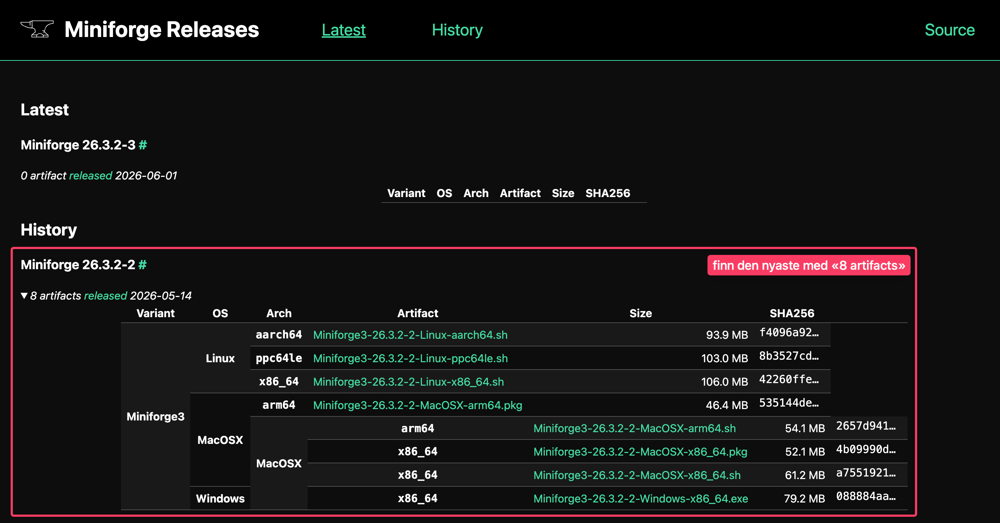

En kort guide for å installere og åpne Jupyter Lab med Miniforge.

::: {.callout-tip collapse="true"}
## Guiden på 1-2-3

[1) Installere Miniforge](#installere)

[2) Lage et miljø med Jupyter Lab og viktige pakker](#miljo)

[3) Lage en mappe til filene](#mappe)

[4) Åpne og kjøre](#aapne)
:::



---

## 1 Installere Miniforge {#installere}

Miniforge laster du ned [her](https://conda-forge.org/download/).

::: callout-important
## Viktig

Velg fila som passer til maskinen din:

::: {.panel-tabset group="os"}
## Mac
-   **Mac med Apple-brikke (M1, M2, M3, M4):** `Miniforge3-MacOSX-arm64.pkg`

-   **Mac med Intel:** `Miniforge3-MacOSX-x86_64.pkg`

Er du usikker på hva slags Mac du har? Klikk på eplet øverst til venstre → «Om denne datamaskinen» → se på linja «Brikke» eller «Prosessor».

## Windows
-   **Windows:** `Miniforge3-Windows-x86_64.exe`
:::

{fig-align="center"}
:::

Når du har lastet ned fila:

-   åpne nedlastinger og klikk på fila
-   følg installasjonsveiledningen
-   på Windows: la det stå kryss ved **«Create start menu shortcuts»**
-   **OBS:** Du trenger **ikke** lage bruker eller logge inn noe sted.

## 2 Lage et miljø med Jupyter Lab og viktige pakker {#miljo}

Resten av installasjonen skjer i terminalen. Det er litt ulikt på Mac og Windows.

::: {.panel-tabset group="os"}
## Mac
Åpne programmet «Terminal».
Du kan søke etter appen med Spotlight: enten forstørrelsesglasset på menylinja øverst på skjermen eller snarveien  på tastaturet.

## Windows
Åpne programmet «Miniforge Prompt».
Du kan søke etter appen fra Start-menyen. Trykk på -tasten på tastaturet.
:::

I programmet/terminalen skal du skrive litt kode. Trykk  etter hver linje. Husk at du kan kopiere inn kodelinjene herfra. Du trenger ikke skrive av.

``` bash
conda create -n geofag2 python=3.13 jupyterlab numpy matplotlib pandas scipy ipywidgets xarray netcdf4 cartopy requests
```

**OBS:** dette er et forslag, du kan legge til eller trekke fra pakker etter behov. 
Når programmet har tenkt seg om (av og til ganske lenge) får du opp `Proceed ([y]/n)?`. Trykk  for å fortsette.

Nå har vi laget et *miljø* (et roterom) der vi har installert alt vi trenger. Blir det kluss, eller vi trenger andre pakker og programmer i andre fag, kan vi lage nye miljø.

## 3 Lage en mappe til filene {#mappe}

Notatbøker og data til Geofag 2 skal ligge i en egen mappe, `Geofag2-filer`. Da slipper du å lete etter dem blant alt annet i Nedlastinger.

Skriv inn i , og trykk :

``` bash
mkdir Geofag2-filer
```

Mappa ligger i hjemmemappa di, den som har samme navn som brukeren din. Har du laget mappa før, får du beskjed om at den finnes allerede. Det gjør ingenting.

::: callout-note
## Mappe og miljø er to forskjellige ting
`Geofag2-filer` er mappa der *filene* dine ligger. `geofag2` er *miljøet* med Python og pakkene. Du trenger begge.
:::

Vil du se mappa i , skriver du disse to linjene:

::: {.panel-tabset group="os"}
## Mac
``` bash
cd Geofag2-filer
open .
```

Dra gjerne mappa inn under «Favoritter» i sidefeltet i Finder, så finner du den lett igjen.

## Windows
``` bash
cd Geofag2-filer
explorer .
```

Høyreklikk gjerne mappa og velg «Fest til Hurtigtilgang», så finner du den lett igjen.
:::

Husk punktumet til slutt. Det betyr «mappa jeg står i».

## 4 Åpne og kjøre {#aapne}

::: callout-tip
## Tips
Det som står videre her er måten du åpner Jupyter Lab på. **Alltid**.
:::

**1) Åpne .**

**2) Skriv inn**

``` bash
conda activate geofag2
```

Du ser at du har gjort riktig om det står `(geofag2)`, og ikke `(base)` foran brukernavnet ditt.

**3) Gå til mappa med filene**

``` bash
cd Geofag2-filer
```

Terminalen starter alltid i hjemmemappa di, så du kommer rett inn i mappa `Geofag2-filer`.

**4) Skriv inn**

``` bash
jupyter lab
```
Nå åpner programmet seg i en fane i nettleseren. Lista til venstre viser filene i `Geofag2-filer`.

::: callout-tip
## Lukke
Når du er ferdig med programmet, lukker du fanen i nettleseren.
**I tillegg** går du tilbake til  og trykker  på tastaturet.
:::

::: {.callout-warning collapse="true"}
## Om noe går galt
**«conda: command not found» / «conda gjenkjennes ikke»**\
Lukk terminalvinduet helt og åpne det på nytt. På Windows: pass på at du bruker «Miniforge Prompt», ikke vanlig «Ledetekst» eller PowerShell.

**Det står fortsatt `(base)`**\
Da er miljøet ikke aktivert. Kjør `conda activate geofag2` på nytt og se etter skrivefeil i navnet.

**«EnvironmentNameNotFound»**\
Miljøet er ikke laget ennå, *eller* så er det skrivefeil. Gå tilbake til [steg 2](#miljo).

**«No such file or directory» / «Finner ikke angitt bane» når du skriver `cd Geofag2-filer`**\
Mappa er ikke laget ennå, *eller* så er det skrivefeil. Gå tilbake til [steg 3](#mappe).

**Jeg finner ikke filene mine i Jupyter Lab**\
Du har startet Jupyter Lab i feil mappe. Lukk med , skriv `cd Geofag2-filer` og start `jupyter lab` på nytt.

**Nettleserfanen åpner seg ikke av seg selv**\
Kopier adressen som begynner med `http://localhost:8888/...` fra terminalen og lim den inn i nettleseren.
:::

---

## Videre

-   [Driftvarsling med OpenDrift](opendrift.html): lag et eget miljø med OpenDrift og kjør en notatbok med ferske varsler fra Meteorologisk institutt.
